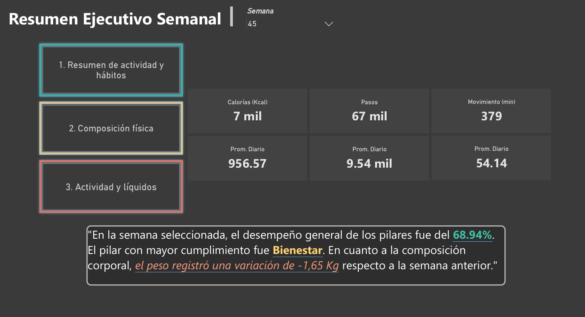
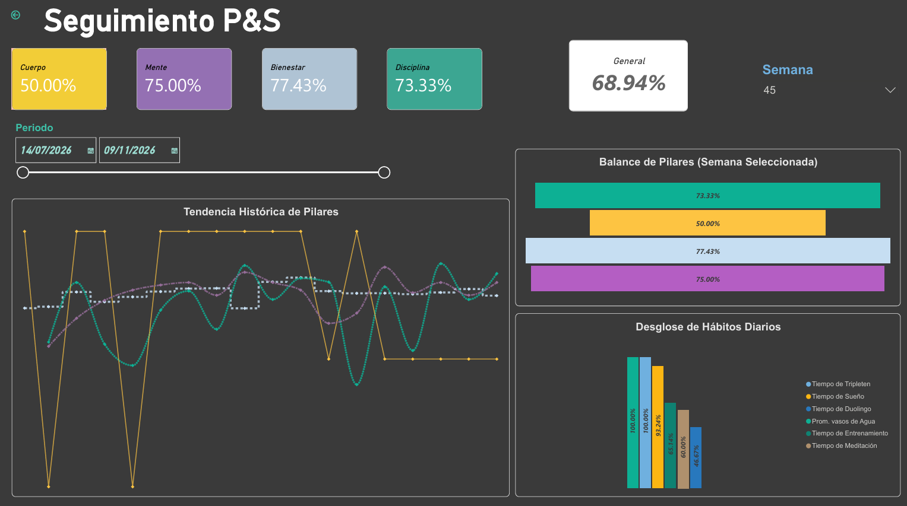
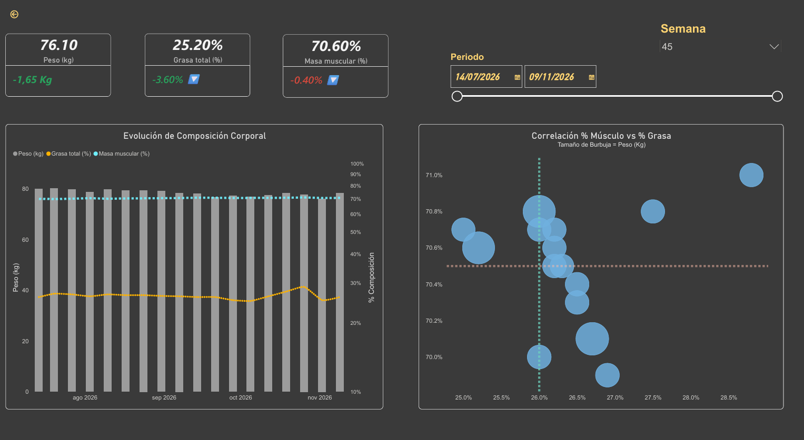
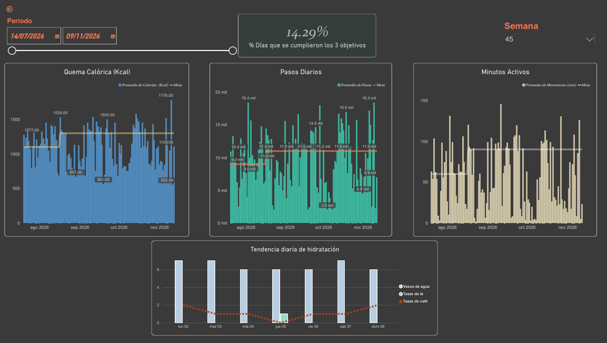

# 📈 P&S: Personal Performance & Wellness Analytics (Power BI Portfolio Project)

## 🎯 Project Overview
**P&S (Personal Performance & Wellness Analytics)** is an interactive, multi-page Business Intelligence solution developed with **Microsoft Power BI** to transform daily personal tracking records into actionable insights. 

The project focuses on monitoring personal performance across four key dimensions:
* 🔋 **Body:** Physical progress and body composition.
* 🧠 **Mind:** Learning, cognitive development, and mental activities.
* 🌿 **Well-being:** Daily habits and personal wellness.
* 🎯 **Discipline:** Consistency, routines, and goal completion.

Instead of simply displaying metrics, this dashboard is designed to identify trends, evaluate habit compliance, and support data-driven personal progress decisions.

---

## 🖼️ Dashboard Architecture

### 1. Executive Summary
A high-level overview of weekly performance, displaying total and average daily activity metrics, date/week filters, and an automatically generated narrative highlighting the highest-performing pillar.
*Purpose:* Provide an immediate understanding of overall performance without requiring users to navigate through every analytical section.

### 2. Personal Performance Tracking
A detailed analysis of the four performance pillars, tracking historical trends, weekly comparisons, and compliance across daily habits.
*Purpose:* Evaluate consistency, identify performance gaps, and understand how individual habits contribute to overall results.

### 3. Health & Body Composition
A dedicated view for monitoring physical progress, including weight tracking, body fat, and muscle mass trends, alongside a scatter plot exploring composition correlations.
*Purpose:* Visualize changes in body composition over time and identify general trends. *(Note: Visual association does not establish causation).*

### 4. Physical Activity & Hydration
A granular view of daily physical activity, active minutes, and fluid consumption (water, tea, and coffee) with goal-compliance markers.
*Purpose:* Evaluate daily activity patterns, measure goal completion, and monitor hydration habits.

---

## 💡 Key Findings & Applied Analytical Concepts:

* **Performance Overview (Week 45):** General compliance was **68.94%**[cite: 38], with **Well-being (77.43%)**[cite: 38] and **Mind (75.00%)**[cite: 38] leading the performance pillars, while **Body** rested at **50.00%**[cite: 38]. Weight registered a decrease of **-1.65 Kg** compared to the previous week[cite: 38].
  
* **Habit Compliance:** Highly consistent behaviors include *Tripleten* (100.00%) and *Sleep* (100.00%), whereas *Meditation* (46.67%) was identified as the primary point of friction.
  
* **Health Metrics:** Historical patterns indicate steady muscle mass (approx. 70.60%) alongside body fat percentage variations (25.20% avg.), with bubble sizing mapped to overall weight[cite: 39] to contextualize composition changes.
  
* **Applied Concepts:** Key Performance Indicators (KPIs)[cite: 38, 39], Time-Based Analysis[cite: 38, 39, 41], Historical Trend Tracking[cite: 38, 39, 41], Compliance Benchmarking, Interactive Date Segmentation[cite: 38, 39, 41], and Exploratory Data Analysis[cite: 39].

---

## 🛠️ Technologies & Skills
* **Microsoft Power BI:** Dashboard development, interactive reporting, and unified design.
* **Data Modeling & DAX:** KPI calculations, YTD metrics, custom weekly comparisons, and narrative generation.
* **Data Visualization:** Selection of charts, color consistency, and explorer bubble plots[cite: 39].
* **Business Intelligence:** Decision support and multi-perspective tracking logic.

---

## 📂 Repository Structure:

* `Dashboard/P&S_Final.pbix`: The primary interactive Power BI Desktop file.
  
* `Assets/`: Directory containing dashboard views (`executive-summary.png`, `performance-tracking.png`, `health-analysis.png`, `activity-analysis.png`).
  
* `Data/sample_anonymized_data.xlsx`: Anonymized dataset for auditability.
  
* `Documentation/project-documentation.md`: Technical metrics breakdown and project context.

## 🚀 How to explore the project
1. Clone this repository: git clone https://github.com/ricardomc41-3006/P-S_Personal_Performance_Analytics.git
